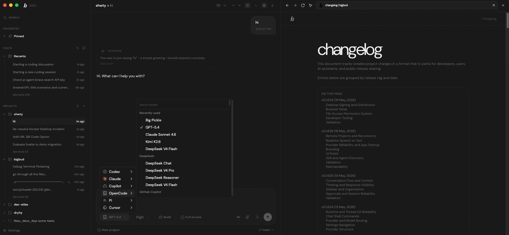
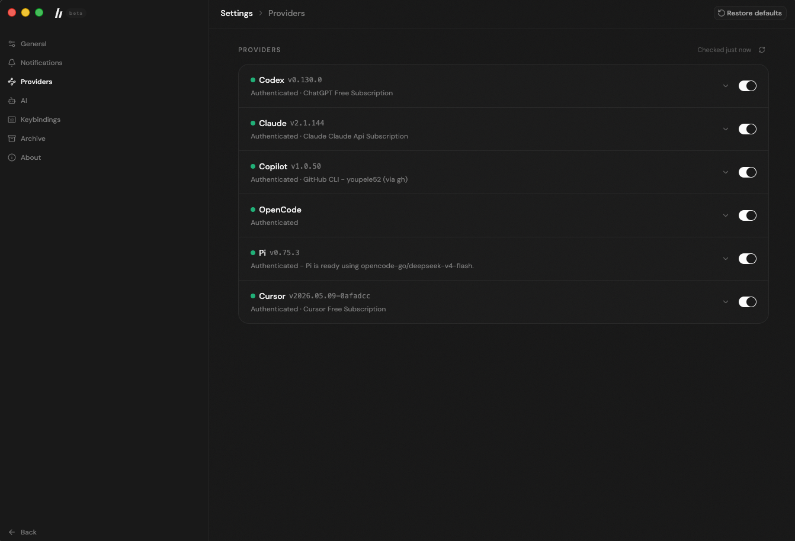

# bigbud

<p align="center">
  
</p>

**Switch agents. Not workspaces.**

bigbud is an AI workspace for knowledge work, from researching an idea to writing a report or building software. Use the agents you already like and keep your chats, files, and notes together. When a task needs more than a reply, your agent can browse the web or, with your permission, work directly in your desktop apps.

## Table of Contents

- [Features](#features)
- [Quick Install](#quick-install)
  - [Desktop App](#desktop-app)
  - [From Source](#from-source)
- [Provider Setup](#provider-setup)
- [Orchestra and Agent Coordination](#orchestra-and-agent-coordination)
- [Search and Quick Open](#search-and-quick-open)
- [Remote Projects](#remote-projects)
- [Remote Backends](#remote-backends)
- [Mobile Companion](#mobile-companion)
- [Scheduled Tasks](#scheduled-tasks)
- [Workspace Tools](#workspace-tools)
- [Terminal](#terminal)
- [Computer Use](#computer-use)
- [Speech to Text](#speech-to-text)
- [Inyosira](#inyosira)
- [System Monitor](#system-monitor)
- [Usage Dashboard](#usage-dashboard)
- [Games](#games)
- [Desktop vs Web](#desktop-vs-web)
- [Documentation](#documentation)
- [Development](#development)
  - [Desktop Packaging](#desktop-packaging)
- [Status](#status)

## Features

- **[Orchestra and agent coordination](#orchestra-and-agent-coordination)** — Run agents in parallel, hand work from one to another, and coordinate chats across projects.
- **[Search and Quick Open](#search-and-quick-open)** — Find past conversations, terminal output, and files without remembering where you left them.
- **Work across devices** — Open [remote folders over SSH](#remote-projects), run bigbud on [your own Linux server](#remote-backends), or check in from [your phone](#mobile-companion).
- **[Multiple providers](#provider-setup)** — Use Codex, Claude, Copilot, OpenCode, Pi, Cursor, and more from one workspace.
- **[Workspace tools](#workspace-tools)** — Keep your browser, files, git changes, notes, Kanban board, and terminal beside your chat.
- **[Inyosira](#inyosira)** — Give your attention to the chats that need it now and set the rest aside.
- **[Scheduled tasks](#scheduled-tasks)** — Set up recurring agent work and review each run when it finishes.
- **Stay in control of each chat** — Follow streamed output and tool activity, answer questions and approvals, pin important chats, or branch a conversation to explore a different direction.
- **[Computer Use](#computer-use) and [voice dictation](#speech-to-text)** — Let an agent work with a browser or desktop app, or speak a prompt instead of typing it.

<p align="center">
  
</p>

## Quick Install

### Desktop App

Download the latest version for your platform at **[bigbud.app/download](https://bigbud.app/download/)**.

Alternatively, install via terminal:

**macOS / Linux:**

```bash
curl -fsSL https://raw.githubusercontent.com/youpele52/bigbud/main/apps/marketing/public/install.sh | sh
```

**Windows:**

```powershell
powershell -NoProfile -ExecutionPolicy Bypass -Command "irm https://raw.githubusercontent.com/youpele52/bigbud/main/apps/marketing/public/install.ps1 | iex"
```

### From Source

Install Node.js 24.13.1 or later in the 24.x series, Bun 1.3.9 or later in the 1.x series, and Rust via rustup. The repository selects the Rust version for you.

```bash
git clone https://github.com/youpele52/bigbud.git
cd bigbud
bun install
bun dev
```

Open [`http://localhost:5733`](http://localhost:5733) in your browser.

For desktop development:

```bash
bun dev:desktop
```

## Provider Setup

1. Open **Settings → Providers** and choose a provider you want to use.
2. Follow its setup prompt to sign in or add credentials. bigbud shows what’s already configured.
3. Start a chat and pick your model in the composer.

You only need one provider to get started. Copilot setup can reuse an existing runtime or install one for you. Pi is included; connect the model provider you want to use.

## Orchestra and Agent Coordination

Open **Quick actions → Orchestrate** to split a task between agents, run them in parallel, or pass work from one to the next. From a chat, you can also ask a supported agent to start or message a chat in another project. Replies come back to the conversation that asked, and bigbud asks for permission when the agent needs access you haven’t granted.

## Search and Quick Open

- **`Cmd/Ctrl+F`** searches conversations, projects, recent terminal output, and files. It can include your computer and already connected remote hosts, depending on your file access settings. When a terminal is focused, it searches that terminal instead.
- **`Cmd/Ctrl+P`** opens the command palette and finds files by name in your projects and across permitted local and connected remote locations.

## Remote Projects

Open a folder on another machine from **Remote Workspaces** in the sidebar without moving your whole bigbud setup there. Pick a saved SSH host or add one, then choose the folder you want to work in.

**Direct SSH** is the default for new workspaces and needs no bigbud agent on the host. Choose the **bigbud remote agent** when you want remote terminals that can reattach after a disconnect or to edit remote files from the Files panel. Existing workspaces keep their saved connection method.

## Remote Backends

To run bigbud itself on a Linux server or VM you own, set up a **remote backend**. This is different from opening a folder over SSH: the server runs your chats, providers, and terminals so work can continue when your laptop disconnects. Once the server is set up, use **Open remote backend** in the desktop sidebar to open it in its own window.

When connected to a remote backend, use **Settings → Remote → Peer hosts** to pair another bigbud server you trust. An agent can hand it a task and follow its progress without your laptop staying online.

## Mobile Companion

Open **Settings → Remote → Mobile Remote Control** and pair your phone using the QR code or link. On your phone, you can check chats, send prompts, answer questions and approvals, and review diffs. Use [the Tailscale pairing guide](https://github.com/youpele52/bigbud/blob/main/docs/REMOTE_ACCESS.md#mobile-companion) to connect away from your local network. The companion controls an existing backend; it doesn’t run agents on your phone.

## Scheduled Tasks

Open **Scheduled** in the sidebar to set up recurring agent work. Describe what you want done and when, then review the schedule before enabling it. You can pause a task, run it on demand, or open its run history to see what happened.

## Workspace Tools

Open the right-panel launcher to keep the tools you need next to your chat:

- **Browser and Files** — Browse and annotate pages, preview files (including video where the codec is supported), and edit supported text files in local and remote-agent workspaces. Direct SSH file previews are read-only.
- **Git and Diff** — Review changes and history, annotate diffs, and manage branches and worktrees in Git projects.
- **Notes and Kanban** — Save decisions and drafts, track tasks, and let supported agents read or update notes and cards.

In chat, attach files or another thread for context, or select a passage and choose **Cite** to point your agent to the exact words. Use **Quick actions** to open **Sidecar** for a temporary second conversation or **Tasks** to follow a plan. Supported agents can also show interactive tables and diagrams directly in chat. Use `Cmd/Ctrl+W` to close the active right-panel tab when the terminal isn’t focused.

## Terminal

Open a terminal when you need one, split it into panes, or keep it running while you switch chats. You can also run a quick shell command from the composer with `!`, for example `!ls`. When a long-running command finishes in a pane you aren’t watching, bigbud can move its chat to **Needs you** and notify you.

**Preview:** Start bigbud with `BIGBUD_TERMINAL_HOST=1` to keep local and Direct SSH terminals running across backend restarts on supported systems. **Settings → Terminal → Keep terminals running after quitting** is separate and off by default.

## Computer Use

- **Built-in browser:** Supported agents can navigate, click, type, scroll, and take screenshots in bigbud’s browser on desktop or web. It doesn’t require enabling native desktop control.
- **Desktop apps:** Enable **Settings → AI → Computer Use** and follow the setup prompts. On macOS, agents can click, type, and use keyboard shortcuts once you grant the required permissions and set the chat to **Full access**. Accessibility enables control; Screen Recording allows captures. Windows and Linux support desktop control too, but available actions depend on the system and runtime. **Background** mode avoids taking focus; choose **Foreground** when the task needs it.
- **System browser:** If you prefer your usual browser over bigbud’s built-in one, system-browser interaction requires the desktop app, enabled Computer Use, and a chat in **Full access**.

Capturing or inspecting the desktop does not require Full access, but actions that change it do. **Full access is not a sandbox**; use it only for chats you trust with that level of access.

## Speech to Text

Add your OpenAI API key in **Settings → AI → Speech to Text** and choose **Save & Verify**. In the composer, click the microphone once to start dictating and again to stop. The transcript goes into your draft so you can review it before sending. Audio streams directly to OpenAI, not through the bigbud server.

On macOS, allow microphone access when prompted. If you previously denied it, you can restore it in **System Settings → Privacy & Security → Microphone**.

<p align="center">
  
</p>

## Inyosira

Inyosira means **breathe**. Not everything needs your attention right now. Switch from **Projects** to **Inyosira** in the sidebar to keep what matters in view, see when a chat needs you, and set the rest aside.

- **Present** — Keep the chats you're working on in view.
- **Needs you** — Find chats waiting for an answer or approval.
- **Later** — Set aside chats that can wait. Snooze one to bring it back to **Needs you** when you're ready.
- **Done** — Clear finished work from your active list without archiving or deleting it.

Move chats between groups yourself, or turn on **Keep Present focused** to move inactive chats out of the way while keeping active work in view.


## System Monitor

Open **System Monitor** from the desktop sidebar to see what's keeping your computer busy. Check CPU, memory, storage, and network activity, or switch to the **bigbud** tab to see what the app itself is using. Search running processes and sort them by CPU or memory to find what's consuming the most resources.

You can also select a connected Linux SSH workspace in **System Monitor** or the **System** side panel to see the remote computer's CPU, memory, storage, and network activity. Monitoring uses read-only SSH commands and doesn't require installing the bigbud remote agent.


## Usage Dashboard

Open **Usage** from the sidebar to see where your tokens go. Track usage over time and compare providers and models using activity stored on your device. For supported providers, you can also see how much of your subscription allowance remains and when it resets.


## Games

Open **Games** from the sidebar to play free browser games, from quick puzzles to arcade classics, while your agent keeps working in the background.


## Desktop vs Web

|                     | Desktop                                        | Web                         |
| ------------------- | ---------------------------------------------- | --------------------------- |
| **Installation**    | Native installer                               | `bun dev` or self-hosted    |
| **Server**          | Bundled locally, or connect to your own        | Connects to a bigbud server |
| **Native features** | OS notifications, system tray, desktop control | Browser-based only          |
| **Best for**        | Everyday use                                   | Browser access, development |

## Documentation

- [AGENTS.md](./AGENTS.md) — Agent instructions and package overview
- [Development documentation](./docs/development/README.md) — Architecture, runtime modes, scripts, glossary, and contribution guidance
- [docs/CHANGELOG.md](./docs/CHANGELOG.md) — Recent project changes and grouped release history
- [Contributing](./docs/development/CONTRIBUTING.md) — Contribution guidelines
- [docs/KEYBINDINGS.md](./docs/KEYBINDINGS.md) — Keyboard defaults and configuration
- [docs/COMMANDS.md](./docs/COMMANDS.md) — Complete Bun and just command reference
- [docs/REMOTE_ACCESS.md](./docs/REMOTE_ACCESS.md) — Mobile pairing and remote server access
- [docs/THREAD_RETENTION.md](./docs/THREAD_RETENTION.md) — Cleanup, protections, and recovery
- [Release guide](./docs/development/release.md) — Release workflow & signing
- [Observability](./docs/development/observability.md) — Diagnostic setup and workflows

## Development

Common commands are listed below. See [Commands](./docs/COMMANDS.md) for every root and workspace script, focused invocation examples, and the Bun-to-just mapping.

Use Bun directly or install just and use the equivalent recipes. Run `just` or `just --list` to see available commands; Bun scripts remain unchanged underneath.

| Task                         | Bun                      | just                  |
| ---------------------------- | ------------------------ | --------------------- |
| Install dependencies         | `bun install`            | `just install`        |
| Start development stack      | `bun run dev`            | `just dev`            |
| Start desktop development    | `bun run dev:desktop`    | `just dev-desktop`    |
| Start server development     | `bun run dev:server`     | `just dev-server`     |
| Start web development        | `bun run dev:web`        | `just dev-web`        |
| Start mobile web development | `bun run dev:mobile-web` | `just dev-mobile-web` |
| Build desktop                | `bun run build:desktop`  | `just build-desktop`  |
| Check formatting             | `bun run fmt:check`      | `just fmt-check`      |
| Lint                         | `bun run lint`           | `just lint`           |
| Check types                  | `bun run typecheck`      | `just typecheck`      |
| Run Vitest suite             | `bun run test`           | `just test`           |

```bash
# Full dev stack (contracts + server + web + mobile web)
bun dev

# Individual apps
bun dev:server
bun dev:web
bun dev:desktop

# Run checks
bun fmt
bun lint
bun typecheck
bun run test   # Use this, not "bun test"
```

### Desktop Packaging

```bash
bun dist:desktop:dmg:arm64   # macOS Apple Silicon
bun dist:desktop:dmg:x64     # macOS Intel
bun dist:desktop:linux       # Linux AppImage
bun dist:desktop:win         # Windows NSIS installer
```

## Status

bigbud is actively used and maintained. See the [changelog](https://bigbud.app/changelog/) for recent updates.

We're not accepting external code contributions at the moment. Bug reports and feature requests are welcome as issues, and pull requests are for detailed implementation plans only. See [the contribution guide](https://github.com/youpele52/bigbud/blob/main/docs/development/CONTRIBUTING.md) for details.
