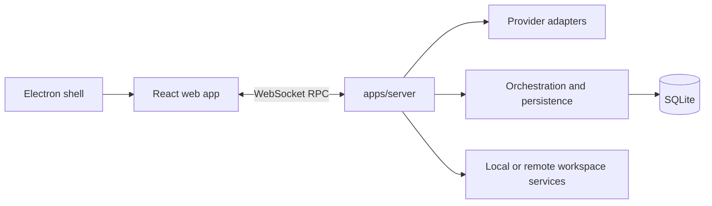

# Architecture

bigbud is a multi-package workspace. The React web app connects to the Node.js/Bun server over WebSocket RPC; the server routes requests to provider adapters and coordinates durable orchestration state. The Electron desktop app embeds the shared web UI and starts the local server. See the [workspace package overview](../../AGENTS.md#package-roles).

## Client and server boundary

The web app's RPC client and [`WsTransport`](../../apps/web/src/rpc/wsTransport.ts) manage the WebSocket connection and its recovery behavior. [`wsNativeApi`](../../apps/web/src/rpc/wsNativeApi.ts) adapts RPC operations to client state, and the native API contracts are defined in `@bigbud/contracts`.

The server creates its runtime in [`server.ts`](../../apps/server/src/server.ts), assembles HTTP and WebSocket routes in [`server.routes.ts`](../../apps/server/src/server.routes.ts), and defines the WebSocket RPC route in [`ws.ts`](../../apps/server/src/ws/ws.ts). The shared RPC group and orchestration schemas live under [`packages/contracts/src`](../../packages/contracts/src).

## Provider and orchestration flow

[`ProviderService`](../../apps/server/src/provider/Layers/ProviderService.ts) owns provider-session routing and delegates provider-specific behavior to registered adapters. Adapter registration is maintained by [`ProviderAdapterRegistry`](../../apps/server/src/provider/Layers/ProviderAdapterRegistry.ts); provider implementations and their runtime-specific requirements are intentionally kept behind that boundary.

Provider runtime events are normalized by [`ProviderRuntimeIngestion`](../../apps/server/src/orchestration/Layers/ProviderRuntimeIngestion.ts) and applied by the [`OrchestrationEngine`](../../apps/server/src/orchestration/Layers/OrchestrationEngine.ts). The engine persists canonical domain events and updates the projected read model. [`ProviderCommandReactor`](../../apps/server/src/orchestration/Layers/ProviderCommandReactor.ts) handles provider side effects, while [`CheckpointReactor`](../../apps/server/src/orchestration/Layers/CheckpointReactor.ts) coordinates workspace checkpoints and turn diffs.

Some server work continues after the initiating RPC returns. Queue-backed workers and internal runtime receipts coordinate follow-up work; tests use the relevant worker or service test facilities rather than assuming that an RPC response means all asynchronous work has settled. See [`RuntimeReceiptBus`](../../apps/server/src/orchestration/Services/RuntimeReceiptBus.ts).

## Desktop event delivery

For packaged desktop sessions, `bigbud-desktop-supervisor` coordinates delivery of canonical orchestration events to the web consumer. The TypeScript server and SQLite remain the source of truth for event existence and meaning; the supervisor coordinates bounded delivery, acknowledgements, and recovery. Standalone server and mobile-remote consumers use the supported TypeScript delivery path. See [Desktop Event Delivery in the README](../../README.md#desktop-event-delivery) and the [Rust crate guidance](../../crates/AGENTS.md).

The [delivery-authority ADR](../decisions/2026-08-27-desktop-delivery-supervisor-authority.md) records the ownership and recovery decision; the [codebase glossary](./encyclopedia.md#desktop-orchestration-delivery) defines canonical domain authority, application acknowledgement, controlled fallback, and direct unmanaged delivery.

Packaged Electron supplies `BIGBUD_DESKTOP_SUPERVISOR_BINARY` and sets `BIGBUD_DESKTOP_PACKAGED=1`. Development may opt in with `BIGBUD_DESKTOP_SUPERVISOR_ENABLED=1` and a resolved binary; `0` selects direct unmanaged delivery at startup. Missing or invalid native configuration selects a fenced fallback. Runtime recovery and fallback must preserve the last verified application cursor and fence older generations; a new subscription makes a new route decision. See [supervisor configuration](../../apps/server/src/desktop-supervisor/desktopSupervisorConfig.ts).
